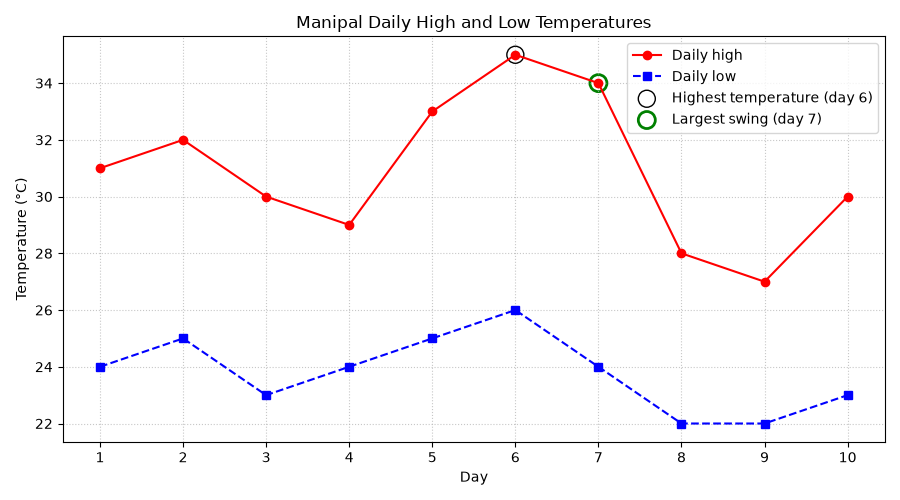

# SYNERGY TASK PHASE

## QUESTION
Q16. Manipal Weather Swings. Plot both series on one line chart with different markers and line styles, a legend, a grid and labelled axes (with units). Use NumPy to find the day with the largest daily range (high − low). Interpret: does the day with the highest temperature also have the largest swing?

## PROGRAM
```
import pandas as pd
import numpy as np
import matplotlib.pyplot as plt

days = np.arange(1, 11)
high = np.array([31, 32, 30, 29, 33, 35, 34, 28, 27, 30])
low = np.array([24, 25, 23, 24, 25, 26, 24, 22, 22, 23])

daily_range = high - low
print("Daily range:", daily_range)

# Day with the largest swing
swing_idx = np.argmax(daily_range)
print("Day with largest range:", days[swing_idx], "->", daily_range[swing_idx], "°C")

# Day with the highest temperature
peak_idx = np.argmax(high)
print("Highest temperature:", high[peak_idx], "°C on day", days[peak_idx])
print("Range on that day:", daily_range[peak_idx], "°C")
print("Mean daily range:", round(daily_range.mean(), 2), "°C")

# Line chart
plt.figure(figsize=(9, 5))
plt.plot(days, high, color='red', marker='o', linestyle='-', label='Daily high')
plt.plot(days, low, color='blue', marker='s', linestyle='--', label='Daily low')

# Highlight the two special days
plt.scatter(days[peak_idx], high[peak_idx], s=150, facecolors='none',
            edgecolors='black', label='Highest temperature (day 6)')
plt.scatter(days[swing_idx], high[swing_idx], s=150, facecolors='none',
            edgecolors='green', linewidths=2, label='Largest swing (day 7)')

plt.title('Manipal Daily High and Low Temperatures')
plt.xlabel('Day')
plt.ylabel('Temperature (°C)')
plt.xticks(days)
plt.grid(True, linestyle=':', alpha=0.7)
plt.legend()
plt.tight_layout()
plt.show()
```

## OUTPUT
```
C:\Users\anups\SYNERGY>python panda15.py
Rows before / after dedup: 11 / 10
Events with no fee listed: ['City Landscaping', 'Salutes And Ladders']

Registrations per event:
 event
City Landscaping       2
Hackathon              2
Open Mic               2
Quiz Night             2
Robo Race              1
Salutes And Ladders    1
dtype: int64

Revenue per department (deduplicated):
 dept
ECE        400.0
CSE        200.0
Unknown     50.0
MECH         0.0
Name: fee, dtype: float64
Total revenue: 650.0

Revenue per department (duplicates kept):
 dept
ECE        400.0
CSE        200.0
Unknown     50.0
MECH         0.0
Name: fee, dtype: float64
Registrations per event (duplicates kept):
 event
City Landscaping       3
Hackathon              2
Open Mic               2
Quiz Night             2
Robo Race              1
Salutes And Ladders    1
dtype: int64

C:\Users\anups\SYNERGY>python panda16.py
Daily range: [ 7  7  7  5  8  9 10  6  5  7]
Day with largest range: 7 -> 10 °C
Highest temperature: 35 °C on day 6
Range on that day: 9 °C
Mean daily range: 7.1 °C
```



## Interpretation
No,  I believe that the day with the highest temperature is day 6 at 35°C, but the largest temperature swing is on day 7 at 10°C. This is because the temperature range depends on both the high and low temperatures, not just the highest temperature.

## Explaination of code
irst I created the NumPy arrays for days, highs and lows. I subtracted the low array from the high array to get the daily range for all 10 days at once, without a loop. `np.argmax()` returns the position of the largest value, so `days[swing_idx]` converts that position into the actual day number. I did the same on the `high` array to find the hottest day. Then I plotted both series on one chart, with different colours, markers (`o` and `s`) and line styles (solid and dashed), so they can be told apart even in a black-and-white printout. I added axis labels with the unit (°C), a title, a grid and a legend. The two rings mark the hottest day and the day with the biggest swing.