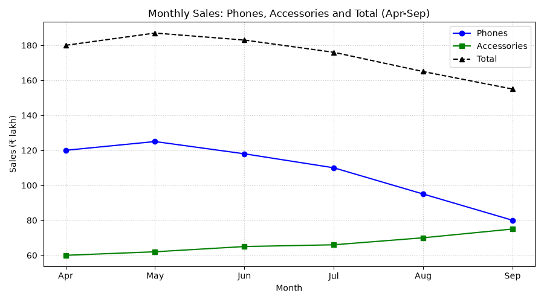

# SYNERGY TASK PHASE

## QUESTION
Values are monthly sales in ₹ lakh. Use Pandas to add a total column, then plot phones, accessories and total as three lines (make the total dashed). Add markers, a legend and a title. Interpret: the owner says everything is declining. Is that true? Identify which category drives the fall in total sales and which one is growing.

## PROGRAM
```
import pandas as pd
import matplotlib.pyplot as plt
import numpy as np

store = pd.DataFrame({
    'month': ['Apr', 'May', 'Jun', 'Jul', 'Aug', 'Sep'],
    'phones': [120, 125, 118, 110, 95, 80],
    'accessories': [60, 62, 65, 66, 70, 75]
})

# Vectorized total column
store['total'] = store['phones'] + store['accessories']
print("DataFrame:\n", store)

# Peak month of total sales
peak = store.loc[store['total'].idxmax()]
print("\nTotal peaks in", peak['month'], "at", peak['total'])

# Change from first month (Apr) to last month (Sep)
cols = ['phones', 'accessories', 'total']
change = store[cols].iloc[-1] - store[cols].iloc[0]
pct = (change / store[cols].iloc[0] * 100).round(1)
print("\nChange from Apr to Sep (₹ lakh):\n", change)
print("\nChange in % :\n", pct)

# Is accessories growing every month?
print("\nAccessories rose every month:", (store['accessories'].diff().dropna() > 0).all())

# Accessories share of total
store['acc_share_pct'] = (store['accessories'] / store['total'] * 100).round(1)
print("\nAccessories share of total (%):\n", store[['month', 'acc_share_pct']])

# Line chart
plt.figure(figsize=(9, 5))
plt.plot(store['month'], store['phones'], color='blue', marker='o', linestyle='-', label='Phones')
plt.plot(store['month'], store['accessories'], color='green', marker='s', linestyle='-', label='Accessories')
plt.plot(store['month'], store['total'], color='black', marker='^', linestyle='--', label='Total')

plt.title('Monthly Sales: Phones, Accessories and Total (Apr-Sep)')
plt.xlabel('Month')
plt.ylabel('Sales (₹ lakh)')
plt.grid(True, linestyle=':', alpha=0.7)
plt.legend()
plt.tight_layout()
plt.show()
```

## OUTPUT
```
C:\Users\anups\SYNERGY>python panda17.py
DataFrame:
   month  phones  accessories  total
0   Apr     120           60    180
1   May     125           62    187
2   Jun     118           65    183
3   Jul     110           66    176
4   Aug      95           70    165
5   Sep      80           75    155

Total peaks in May at 187

Change from Apr to Sep (₹ lakh):
 phones        -40
accessories    15
total         -25
dtype: int64

Change in % :
 phones        -33.3
accessories    25.0
total         -13.9
dtype: float64

Accessories rose every month: True

Accessories share of total (%):
   month  acc_share_pct
0   Apr           33.3
1   May           33.2
2   Jun           35.5
3   Jul           37.5
4   Aug           42.4
5   Sep           48.4
```


## Explaination of my code
First I created the DataFrame and added the `total` column by adding `phones` and `accessories` directly, which is a vectorized operation. `idxmax()` on `total` gave the peak month. To measure the change over the period, I subtracted the first row (Apr) from the last row (Sep) for the three columns at once, and divided by the April value to get the percentage change. I used `diff()` on `accessories` to check that the month-to-month change is positive every time. I also added the share of accessories in total sales to see how the mix is changing. For the chart, I plotted the three lines with different colours and markers (`o`, `s`, `^`), and used `linestyle='--'` for the total so it stands apart from the two category lines. I added a title, axis labels with the unit (₹ lakh), a grid and a legend.


## Interpretation
i believe that the owner's statement that everything is declining is not true. Phone sales are decreasing from ₹120 lakh to ₹80 lakh, which is the main reason for the fall in total sales. But accessories sales are growing from ₹60 lakh to ₹75 lakh. So, the owner should focus on finding why phone sales are falling and continue supporting accessories, as they are growing every month.