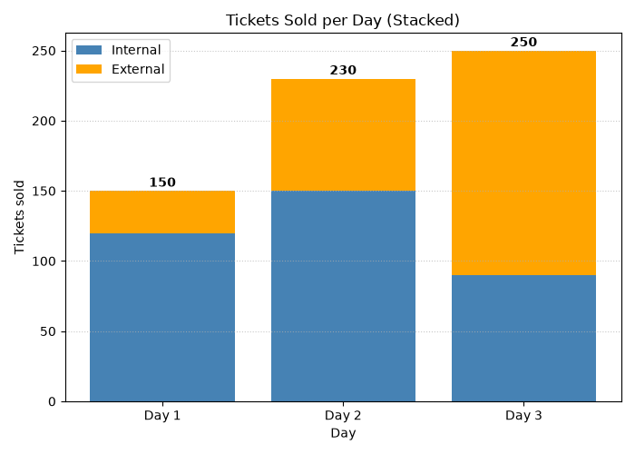
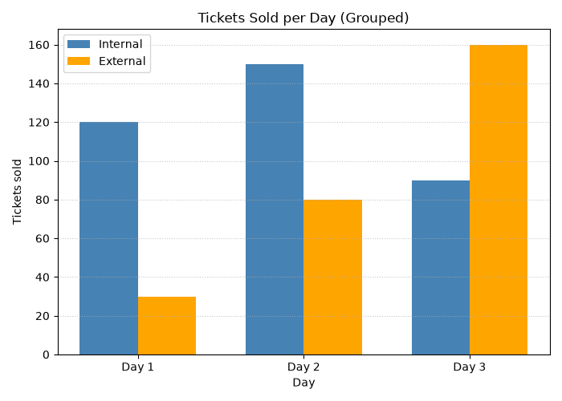

# SYNERGY TASK PHASE

## QUESTION
Q18. Who Is Buying the Tickets? Draw a stacked bar chart of tickets sold per day, split by internal and external visitors. Then draw a grouped bar chart of the same data in a second figure. Design: which chart better shows the total footfall, and which better compares internal against external visitors? Justify in two sentences. Compute the external share for each day and state when the fest was most dependent on outside visitors.

## PROGRAM
```
import numpy as np
import pandas as pd
import matplotlib.pyplot as plt

day = ['Day 1', 'Day 2', 'Day 3']
internal = [120, 150, 90]
external = [30, 80, 160]

df = pd.DataFrame({'day': day, 'internal': internal, 'external': external}).set_index('day')
df['total'] = df['internal'] + df['external']
df['external_share_pct'] = (df['external'] / df['total'] * 100).round(2)
print(df)

peak_day = df['external_share_pct'].idxmax()
print("\nMost dependent on outside visitors:", peak_day, "->", df.loc[peak_day, 'external_share_pct'], "%")
print("Overall external share:", round(df['external'].sum() / df['total'].sum() * 100, 2), "%")

# Figure 1: stacked bar chart
plt.figure(figsize=(7, 5))
plt.bar(day, internal, color='steelblue', label='Internal')
plt.bar(day, external, bottom=internal, color='orange', label='External')
for i, t in enumerate(df['total']):
    plt.text(i, t + 3, str(t), ha='center', fontweight='bold')
plt.title('Tickets Sold per Day (Stacked)')
plt.xlabel('Day')
plt.ylabel('Tickets sold')
plt.legend()
plt.grid(axis='y', linestyle=':', alpha=0.7)
plt.tight_layout()

# Figure 2: grouped bar chart
x = np.arange(len(day))
w = 0.35
plt.figure(figsize=(7, 5))
plt.bar(x - w/2, internal, width=w, color='steelblue', label='Internal')
plt.bar(x + w/2, external, width=w, color='orange', label='External')
plt.xticks(x, day)
plt.title('Tickets Sold per Day (Grouped)')
plt.xlabel('Day')
plt.ylabel('Tickets sold')
plt.legend()
plt.grid(axis='y', linestyle=':', alpha=0.7)
plt.tight_layout()

plt.show()
```

## OUTPUT
```
C:\Users\anups\SYNERGY>python panda18.py
       internal  external  total  external_share_pct
day                                                 
Day 1       120        30    150               20.00
Day 2       150        80    230               34.78
Day 3        90       160    250               64.00

Most dependent on outside visitors: Day 3 -> 64.0 %
Overall external share: 42.86 %
```




## Explaination of my code
First I created the DataFrame, set day as the index and added a `total` column (internal + external). The external share is external ÷ total × 100. `idxmax()` on the share column gives the day that depended most on outsiders. For the stacked chart, I drew the internal bars first and then drew the external bars with `bottom=internal`, so they start where the internal bars end. I wrote the total above each bar with `plt.text()`. For the grouped chart, I used `np.arange` for the day positions and shifted the two sets of bars left and right by half the bar width, so they sit side by side. Both charts have a title, axis labels, a legend and a grid.

## Interpretation
I believe that The stacked chart is better for comparing total visitors each day, while the grouped chart makes it easier to compare internal and external visitors separately. The external share was Day 1: 20%, Day 2: 34.78%, and Day 3: 64%, so the fest was most dependent on outside visitors on Day 3.