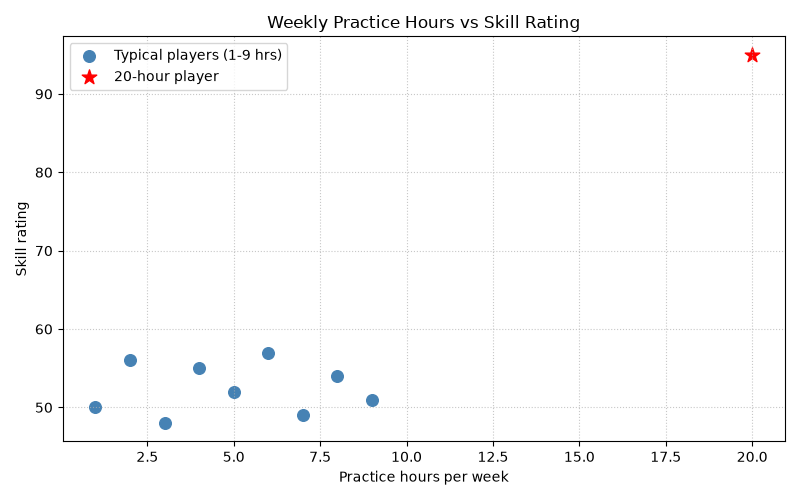

# SYNERGY TASK PHASE

## QUESTION
Q19. Does Practice Really Drive Skill? A gaming coach claims that weekly practice hours drive skill rating. Plot a scatter chart of hours against rating and highlight the player with 20 hours in a different color. Use Pandas to compute the correlation twice: once with all ten players and once without the 20-hour player. Interpret: does the data support the coach's claim for typical players?

## PROGRAM
```
import numpy as np
import pandas as pd
import matplotlib.pyplot as plt

players = pd.DataFrame({
    'hours': [1, 2, 3, 4, 5, 6, 7, 8, 9, 20],
    'rating': [50, 56, 48, 55, 52, 57, 49, 54, 51, 95]
})

# Correlation with all players
corr_all = players['hours'].corr(players['rating'])

# Correlation without the 20-hour player
typical = players[players['hours'] < 20]
corr_typical = typical['hours'].corr(typical['rating'])

print("Correlation (all 10 players)      :", round(corr_all, 4))
print("Correlation (without 20-hr player):", round(corr_typical, 4))
print("\nMean rating of typical players:", round(typical['rating'].mean(), 2))
print("Rating range of typical players:", typical['rating'].min(), "to", typical['rating'].max())

# Scatter chart with the outlier highlighted
outlier = players[players['hours'] == 20]

plt.figure(figsize=(8, 5))
plt.scatter(typical['hours'], typical['rating'], color='steelblue', s=70, label='Typical players (1-9 hrs)')
plt.scatter(outlier['hours'], outlier['rating'], color='red', s=120, marker='*', label='20-hour player')
plt.title('Weekly Practice Hours vs Skill Rating')
plt.xlabel('Practice hours per week')
plt.ylabel('Skill rating')
plt.grid(True, linestyle=':', alpha=0.7)
plt.legend()
plt.tight_layout()
plt.show()
```

## OUTPUT
```
C:\Users\anups\SYNERGY>python panda19.py
Correlation (all 10 players)      : 0.8599
Correlation (without 20-hr player): 0.0285

Mean rating of typical players: 52.44
Rating range of typical players: 48 to 57
```


## Explaination of code
First I created the DataFrame. I used `Series.corr()` on the hours and rating columns to get the correlation for all ten players. Then I used a Boolean mask `players['hours'] < 20` to remove the 20-hour player and computed the correlation again on the remaining nine. For the chart, I plotted the typical players and the 20-hour player as two separate `scatter()` calls, so each gets its own colour, marker and legend entry. The outlier is red and star-shaped, so it stands out. I added a title, axis labels, a grid and a legend.

## Interpretation
I beilieve that the data does not support the coach's claim for typical players. The correlation drops from 0.86 to 0.03 when the player who practised 20 hours is removed, which shows that one unusual player is creating almost the whole relationship. For the other nine players, more practice hours do not clearly lead to higher ratings. We need more data from different players to know whether extra practice really improves ratings.