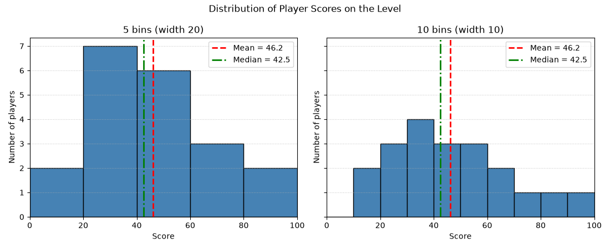

# SYNERGY TASK PHASE

## QUESTION
Q21. How Many Bins Is Too Many? Explain what is wrong with the teammate's approach, then draw the two histograms side by side in two subplots with a shared x-range of 0-100, titles and axis labels. Add vertical lines for the mean and median. Interpret: what shape does the distribution have, and which bin width tells the story better?

## PROGRAM
```
import pandas as pd
import numpy as np
import matplotlib.pyplot as plt

scores = [12, 18, 22, 25, 28, 31, 33, 35, 38, 41, 44, 47, 52, 55, 58, 61, 67, 74, 88, 95]

mean = np.mean(scores)
median = np.median(scores)
print("Mean  :", mean)
print("Median:", median)

# Counts with bins fixed over 0-100
counts5, edges5 = np.histogram(scores, bins=5, range=(0, 100))
counts10, edges10 = np.histogram(scores, bins=10, range=(0, 100))
print("\n5 bins  (width 20):", counts5)
print("10 bins (width 10):", counts10)

# Two subplots side by side, same x-range
fig, axes = plt.subplots(1, 2, figsize=(11, 4.5), sharex=True, sharey=True)

for ax, bins, title in zip(axes, [5, 10], ['5 bins (width 20)', '10 bins (width 10)']):
    ax.hist(scores, bins=bins, range=(0, 100), color='steelblue', edgecolor='black')
    ax.axvline(mean, color='red', linestyle='--', linewidth=2, label=f'Mean = {mean:.1f}')
    ax.axvline(median, color='green', linestyle='-.', linewidth=2, label=f'Median = {median:.1f}')
    ax.set_xlim(0, 100)
    ax.set_title(title)
    ax.set_xlabel('Score')
    ax.set_ylabel('Number of players')
    ax.grid(axis='y', linestyle=':', alpha=0.7)
    ax.legend()

fig.suptitle('Distribution of Player Scores on the Level')
plt.tight_layout()
plt.show()
```

## OUTPUT
```
C:\Users\anups\SYNERGY>python panda20.py
Correlation (all 8 stations)     : 0.408
Correlation (without Industrial) : 0.998

Trend line (non-industrial): pm25 = 29.71 + 0.772 * vehicles_k
  station         zone  vehicles_k  pm25  expected  residual
0      S1  Residential          35    58      56.7       1.3
1      S2  Residential          40    60      60.6      -0.6
2      S3   Commercial          65    80      79.9       0.1
3      S4   Commercial          60    77      76.1       0.9
4      S5   Industrial          45   110      64.5      45.5
5      S6   Industrial          50   115      68.3      46.7
6      S7   Commercial          70    83      83.8      -0.8
7      S8  Residential          30    52      52.9      -0.9

Mean PM2.5 by zone:
 zone
Commercial      80.0
Industrial     112.5
Residential     56.7
Name: pm25, dtype: float64

C:\Users\anups\SYNERGY>python panda21.py 
Mean  : 46.2
Median: 42.5

5 bins  (width 20): [2 7 6 3 2]
10 bins (width 10): [0 2 3 4 3 3 2 1 1 1]
```


## explaination of my code
First I stored the scores and calculated the mean and median with NumPy. I used `np.histogram()` with `range=(0, 100)` to print the count in each bin, so the numbers can be checked against the charts. Then I used `plt.subplots(1, 2, sharex=True, sharey=True)` to make two plots side by side. The same loop draws both histograms, so they get identical formatting. `range=(0, 100)` fixes the bin edges to clean values (0, 20, 40... and 0, 10, 20...), and `set_xlim(0, 100)` sets the same axis on both. `axvline()` draws the mean (red dashed) and the median (green dash-dot), and each line is labelled in the legend. Both plots have a title, axis labels and a grid.

## Interpretation
I came to know that the distribution is slightly right-skewed, meaning most players scored between 20 and 60, but a few high scores stretch the graph to the right. The 5-bin chart (width 20) tells the story better because it shows the main peak and overall shape clearly. The 10-bin chart has too many small bars, so the pattern looks less clear with only 20 players.