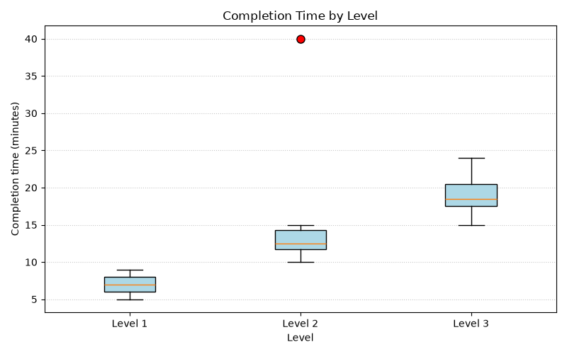

# SYNERGY TASK PHASE

## QUESTION
Draw side-by-side box plots for the three levels. Then use Pandas to compute the median and IQR of each level and apply the 1.5 × IQR rule to list any outliers. Interpret: which level has an unusual completion time, and should the designers worry about the level or about one player?

## PROGRAM
```
import numpy as np
import pandas as pd
import matplotlib.pyplot as plt

times = pd.DataFrame({
    'Level 1': [5, 6, 6, 7, 7, 8, 8, 9],
    'Level 2': [10, 11, 12, 12, 13, 14, 15, 40],
    'Level 3': [15, 16, 18, 18, 19, 20, 22, 24]
})

# Median, quartiles, IQR and fences for every level
summary = pd.DataFrame({
    'median': times.median(),
    'Q1': times.quantile(0.25),
    'Q3': times.quantile(0.75)
})
summary['IQR'] = summary['Q3'] - summary['Q1']
summary['lower_fence'] = summary['Q1'] - 1.5 * summary['IQR']
summary['upper_fence'] = summary['Q3'] + 1.5 * summary['IQR']
print(summary)

# 1.5 x IQR rule: list outliers in each level
print("\nOutliers:")
for level in times.columns:
    col = times[level]
    out = col[(col < summary.loc[level, 'lower_fence']) |
              (col > summary.loc[level, 'upper_fence'])]
    print(level, "->", out.tolist())

# Effect of the outlier on Level 2
l2 = times['Level 2']
print("\nLevel 2 mean with 40   :", l2.mean())
print("Level 2 mean without 40:", round(l2[l2 < 40].mean(), 2))
print("Level 2 median with 40   :", l2.median())
print("Level 2 median without 40:", l2[l2 < 40].median())

# Box plots side by side
plt.figure(figsize=(8, 5))
plt.boxplot([times[c] for c in times.columns], tick_labels=list(times.columns),
            patch_artist=True, boxprops=dict(facecolor='lightblue'),
            flierprops=dict(marker='o', markerfacecolor='red', markersize=8))
plt.title('Completion Time by Level')
plt.xlabel('Level')
plt.ylabel('Completion time (minutes)')
plt.grid(axis='y', linestyle=':', alpha=0.7)
plt.tight_layout()
plt.show()
```

## OUTPUT
```
C:\Users\anups\SYNERGY>python panda22.py
         median     Q1     Q3  IQR  lower_fence  upper_fence
Level 1     7.0   6.00   8.00  2.0          3.0         11.0
Level 2    12.5  11.75  14.25  2.5          8.0         18.0
Level 3    18.5  17.50  20.50  3.0         13.0         25.0

Outliers:
Level 1 -> []
Level 2 -> [40]
Level 3 -> []

Level 2 mean with 40   : 15.875
Level 2 mean without 40: 12.43
Level 2 median with 40   : 12.5
Level 2 median without 40: 12.0
```


## EXPLANATION OF MY CODE
First I created the DataFrame with one column per level. Then I used `median()` and `quantile(0.25)` and `quantile(0.75)` on the whole DataFrame, which computes each statistic for all three levels at once. The IQR is Q3 − Q1. For the 1.5 × IQR rule I calculated the lower fence (Q1 − 1.5 × IQR) and the upper fence (Q3 + 1.5 × IQR). A value outside the two fences is an outlier, so I used a Boolean mask in a loop to list the outliers of each level. I also compared the mean and median of Level 2 with and without the outlier. For the chart, `plt.boxplot()` draws the three boxes side by side, and `flierprops` colours the outlier points red. I added a title, axis labels with the unit (minutes) and a grid

## Interpretation
From the output, i came to know that Level 2 has an unusual completion time because one player took 40 minutes, while the other players finished in 10–15 minutes. This looks more like a problem with one player rather than the whole level, since the other completion times follow the expected difficulty pattern. The designers should check that player's game record to see if they got stuck, faced a bug, or left the game running. One unusual result is a reason to investigate, but not enough proof that the level needs redesigning.