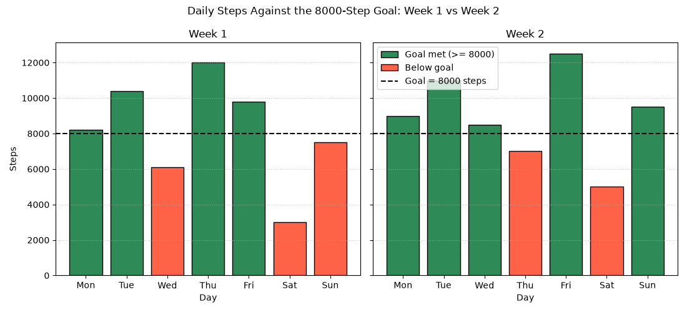

# SYNERGY TASK PHASE

## QUESTION
Q23. Goal Check Across Two Weeks. Create a figure with two subplots side by side that share the y-axis, one per week. Draw bars for the daily steps, add a horizontal reference line at the 8000-step goal, color bars below the goal differently, and give each subplot a title. Use one overall figure title and a sensible figure size. Interpret: did the user improve in the second week?

## PROGRAM
```
import numpy as np
import pandas as pd
import matplotlib.pyplot as plt
from matplotlib.patches import Patch
from matplotlib.lines import Line2D

week1 = [8200, 10400, 6100, 12000, 9800, 3000, 7500]
week2 = [9000, 11000, 8500, 7000, 12500, 5000, 9500]
days = ['Mon', 'Tue', 'Wed', 'Thu', 'Fri', 'Sat', 'Sun']
goal = 8000

steps = pd.DataFrame({'week1': week1, 'week2': week2}, index=days)
steps.index.name = 'day'
steps['change'] = steps['week2'] - steps['week1']
print(steps)

# Summary for each week
for w in ['week1', 'week2']:
    met = (steps[w] >= goal).sum()
    print(f"\n{w}: days meeting goal = {met}, mean = {steps[w].mean():.2f}, "
          f"median = {steps[w].median()}, lowest = {steps[w].min()} "
          f"({steps[w].idxmin()})")

gain = steps['week2'].mean() - steps['week1'].mean()
print(f"\nImprovement in mean: {gain:.2f} steps ({gain / steps['week1'].mean() * 100:.2f} %)")
print("Days that improved:", (steps['change'] > 0).sum(), "of 7")

# Two subplots side by side, shared y-axis
fig, axes = plt.subplots(1, 2, figsize=(11, 5), sharey=True)

for ax, w, title in zip(axes, ['week1', 'week2'], ['Week 1', 'Week 2']):
    colors = np.where(steps[w] >= goal, 'seagreen', 'tomato')
    ax.bar(days, steps[w], color=colors, edgecolor='black')
    ax.axhline(goal, color='black', linestyle='--', linewidth=1.5)
    ax.set_title(title)
    ax.set_xlabel('Day')
    ax.grid(axis='y', linestyle=':', alpha=0.7)

axes[0].set_ylabel('Steps')

handles = [Patch(facecolor='seagreen', edgecolor='black', label='Goal met (>= 8000)'),
           Patch(facecolor='tomato', edgecolor='black', label='Below goal'),
           Line2D([0], [0], color='black', linestyle='--', label='Goal = 8000 steps')]
axes[1].legend(handles=handles, loc='upper left')

fig.suptitle('Daily Steps Against the 8000-Step Goal: Week 1 vs Week 2')
plt.tight_layout()
plt.show()
```

## OUTPUT
```
C:\Users\anups\SYNERGY>python panda23.py
     week1  week2  change
day                      
Mon   8200   9000     800
Tue  10400  11000     600
Wed   6100   8500    2400
Thu  12000   7000   -5000
Fri   9800  12500    2700
Sat   3000   5000    2000
Sun   7500   9500    2000

week1: days meeting goal = 4, mean = 8142.86, median = 8200.0, lowest = 3000 (Sat)

week2: days meeting goal = 5, mean = 8928.57, median = 9000.0, lowest = 5000 (Sat)

Improvement in mean: 785.71 steps (9.65 %)
Days that improved: 6 of 7
```


## Explaination of my code
First I stored the data in a DataFrame with the days as the index and added a `change` column (week 2 minus week 1) to compare each day directly. I counted the days meeting the goal with a Boolean mask `steps[w] >= goal` and `sum()`, since True counts as 1. `plt.subplots(1, 2, figsize=(11, 5), sharey=True)` makes two plots side by side that use the same y-axis, so the bar heights are comparable between the weeks. `np.where(steps[w] >= goal, 'seagreen', 'tomato')` picks a colour for every bar in one step, so there is no loop over bars. `axhline(8000)` draws the dashed goal line, and `set_title()` gives each subplot its own title. `suptitle()` gives the whole figure one overall title. Because the bars use two colours, the default legend would not describe them, so I built the legend by hand with `Patch` and `Line2D` handles. The y-axis label is set only on the left subplot, because the axis is shared.

## Interpretation
Yes, the user improved in the second week. I can see thsat the average steps increased from 8,143 to 8,929 per day, and the user reached the goal on 5 days instead of 4. Most days showed improvement, but Thursday's steps decreased a lot. Saturday was still the weakest day in both weeks. Overall, the user is doing better, but tracking for a few more weeks will help confirm the progress.