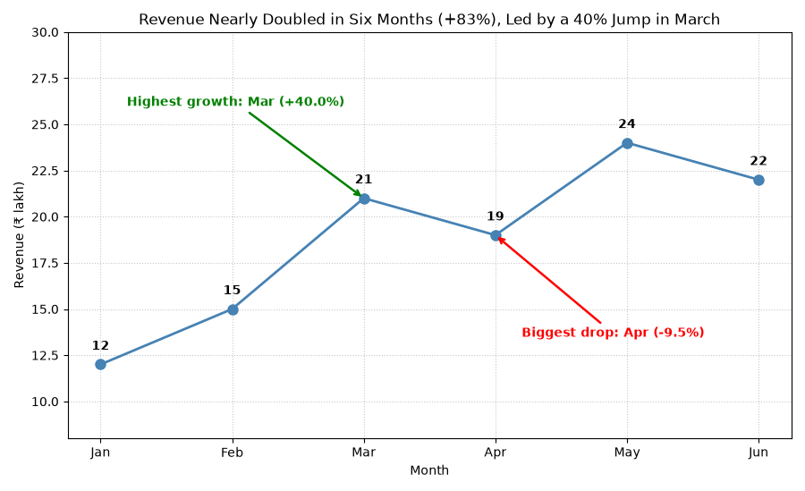

# SYNERGY TASK PHASE

## QUESTION
Q24. Telling the Revenue Story. Revenue is in ₹ lakh. Use pct_change to compute month-over-month growth. Plot revenue as a line with markers, write the value above each point, and use annotations with arrows to mark the month with the highest growth and the month with the biggest drop. Set a suitable figure size, axis labels and a title that states the finding. Interpret: write one sentence the founder could present to investors.

## PROGRAM
```
import numpy as np
import pandas as pd
import matplotlib.pyplot as plt

revenue = pd.DataFrame({'month': ['Jan', 'Feb', 'Mar', 'Apr', 'May', 'Jun'],
                        'revenue': [12, 15, 21, 19, 24, 22]})

# Month-over-month growth in %
revenue['growth_pct'] = (revenue['revenue'].pct_change() * 100).round(2)
print(revenue)

# Best and worst months (the first month is NaN and is ignored by idxmax/idxmin)
best_i = revenue['growth_pct'].idxmax()
worst_i = revenue['growth_pct'].idxmin()
best, worst = revenue.loc[best_i], revenue.loc[worst_i]
print("\nHighest growth:", best['month'], f"{best['growth_pct']:+.1f}%")
print("Biggest drop  :", worst['month'], f"{worst['growth_pct']:+.1f}%")

# Overall picture
first, last = revenue['revenue'].iloc[0], revenue['revenue'].iloc[-1]
total_growth = (last / first - 1) * 100
monthly_rate = ((last / first) ** (1 / 5) - 1) * 100
print("\nTotal growth Jan -> Jun:", round(total_growth, 2), "%")
print("Compound monthly growth:", round(monthly_rate, 2), "%")
print("Months with a fall:", list(revenue.loc[revenue['growth_pct'] < 0, 'month']))

# Line chart with annotations
fig, ax = plt.subplots(figsize=(9, 5.5))
ax.plot(revenue['month'], revenue['revenue'], color='steelblue',
        marker='o', linewidth=2, markersize=8)

# Value above each point
for i, v in enumerate(revenue['revenue']):
    ax.text(i, v + 0.8, str(v), ha='center', fontweight='bold')

# Arrow annotations
ax.annotate(f"Highest growth: {best['month']} ({best['growth_pct']:+.1f}%)",
            xy=(best_i, revenue.loc[best_i, 'revenue']), xytext=(0.2, 26),
            arrowprops=dict(arrowstyle='->', color='green', linewidth=1.8),
            color='green', fontweight='bold')
ax.annotate(f"Biggest drop: {worst['month']} ({worst['growth_pct']:+.1f}%)",
            xy=(worst_i, revenue.loc[worst_i, 'revenue']), xytext=(3.2, 13.5),
            arrowprops=dict(arrowstyle='->', color='red', linewidth=1.8),
            color='red', fontweight='bold')

ax.set_ylim(8, 30)
ax.set_title('Revenue Nearly Doubled in Six Months (+83%), Led by a 40% Jump in March')
ax.set_xlabel('Month')
ax.set_ylabel('Revenue (₹ lakh)')
ax.grid(True, linestyle=':', alpha=0.7)
fig.tight_layout()
plt.show()
```

## OUTPUT
```
C:\Users\anups\SYNERGY>python panda24.py
  month  revenue  growth_pct
0   Jan       12         NaN
1   Feb       15       25.00
2   Mar       21       40.00
3   Apr       19       -9.52
4   May       24       26.32
5   Jun       22       -8.33

Highest growth: Mar +40.0%
Biggest drop  : Apr -9.5%

Total growth Jan -> Jun: 83.33 %
Compound monthly growth: 12.89 %
Months with a fall: ['Apr', 'Jun']
```



## Explaination of my code
First I created the DataFrame and used `pct_change()` on the revenue column. It gives (this month − last month) ÷ last month for every row, and I multiplied by 100 to get percentages. The first month has no previous month, so its growth is NaN, which is correct. `idxmax()` and `idxmin()` skip NaN and return the row of the highest growth and the biggest drop, so the annotations pick the months automatically instead of having them typed in. For the chart, I plotted the line with `marker='o'` and wrote each value above its point using `ax.text()` with a small offset. `ax.annotate()` draws the arrows: `xy` is the point the arrow touches and `xytext` is where the text sits, and `arrowprops` styles the arrow. I placed the texts away from the line so they do not hide the data, and set `ylim` to leave space for them. The title states the finding, and the axes have labels with the unit (₹ lakh). I also computed the total growth from January to June and the compound monthly growth rate, to support the sentence for the investors.

## Interpretation
“Our monthly revenue increased from ₹12 lakh in January to ₹22 lakh in June, showing an overall growth of 83.3%, despite small drops in April and June.”This i believe that one line founderds can present to investors.