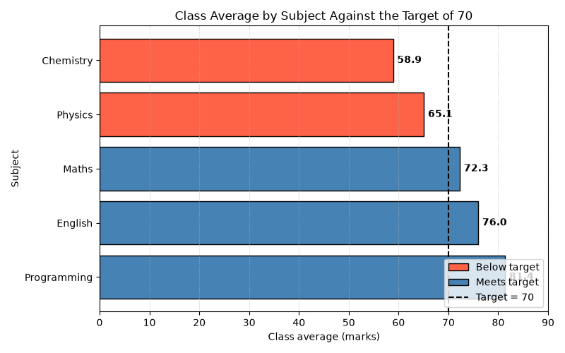

# SYNERGY TASK PHASE

## QUESTION
Q25. Publication-Ready Dashboard Figure. Create a horizontal bar chart of class averages sorted from lowest to highest. Color bars below the target differently, draw a vertical reference line at 70, write the value at the end of each bar, and set a title, axis labels and figsize=(8, 5). Save the figure as task_4/figures/subject_performance.png at 300 dpi with a tight bounding box (create the folder if it does not exist) and confirm the file exists. Explain why a blank image appears when plt.show() is called before plt.savefig(...), and give the correct order. Interpret: which subjects need attention?

## PROGRAM
```
import os
import numpy as np
import pandas as pd
import matplotlib.pyplot as plt
from matplotlib.patches import Patch
from matplotlib.lines import Line2D

subjects = ['Maths', 'Physics', 'Programming', 'Chemistry', 'English']
class_avg = [72.3, 65.1, 81.4, 58.9, 76.0]
target = 70

# Sort from lowest to highest and measure the gap to the target
df = pd.DataFrame({'subject': subjects, 'avg': class_avg}).sort_values('avg').reset_index(drop=True)
df['gap'] = (df['avg'] - target).round(1)
print(df)

below = df[df['avg'] < target]
print("\nBelow target:", list(below['subject']))
print("Mean of the five class averages:", round(df['avg'].mean(), 2))

# Bar chart
colors = np.where(df['avg'] < target, 'tomato', 'steelblue')

fig, ax = plt.subplots(figsize=(8, 5))
ax.barh(df['subject'], df['avg'], color=colors, edgecolor='black')
ax.axvline(target, color='black', linestyle='--', linewidth=1.5)

# Value at the end of each bar
for i, v in enumerate(df['avg']):
    ax.text(v + 0.8, i, f'{v:.1f}', va='center', fontweight='bold')

ax.invert_yaxis()          # lowest average at the top, so the list reads lowest -> highest
ax.set_xlim(0, 90)
ax.set_title('Class Average by Subject Against the Target of 70')
ax.set_xlabel('Class average (marks)')
ax.set_ylabel('Subject')
ax.grid(axis='x', linestyle=':', alpha=0.7)

handles = [Patch(facecolor='tomato', edgecolor='black', label='Below target'),
           Patch(facecolor='steelblue', edgecolor='black', label='Meets target'),
           Line2D([0], [0], color='black', linestyle='--', label='Target = 70')]
ax.legend(handles=handles, loc='lower right')
fig.tight_layout()

# Create the folder, SAVE FIRST, then show
folder = os.path.join('task_4', 'figures')
os.makedirs(folder, exist_ok=True)
path = os.path.join(folder, 'subject_performance.png')
fig.savefig(path, dpi=300, bbox_inches='tight')

print("\nSaved to:", path)
print("File exists:", os.path.exists(path))

plt.show()
```

## OUTPUT
```
C:\Users\anups\SYNERGY>python panda25.py
       subject   avg   gap
0    Chemistry  58.9 -11.1
1      Physics  65.1  -4.9
2        Maths  72.3   2.3
3      English  76.0   6.0
4  Programming  81.4  11.4

Below target: ['Chemistry', 'Physics']
Mean of the five class averages: 70.74

Saved to: task_4\figures\subject_performance.png
File exists: True
```


## Explaination of my code
First I created a DataFrame and used `sort_values('avg')` to sort from lowest to highest. I added a `gap` column (average − target) to see how far each subject is from 70. `np.where(df['avg'] < target, 'tomato', 'steelblue')` chooses a colour for every bar in one step. I used `barh()` for the horizontal bars and `axvline(70)` for the dashed target line. A loop with `ax.text()` writes each value just beyond the end of its bar, and `set_xlim(0, 90)` leaves room so the longest label is not cut off. Since `barh()` draws the first bar at the bottom, I used `invert_yaxis()` so the lowest average appears at the top and the chart reads from lowest to highest. I built the legend by hand with `Patch` and `Line2D`, because the two bar colours come from one `barh()` call. `os.makedirs(folder, exist_ok=True)` creates `task_4/figures` if it is missing and does nothing if it already exists. Then `fig.savefig(path, dpi=300, bbox_inches='tight')` saves the image at 300 dpi, and `bbox_inches='tight'` trims the extra white margin so no label is cut off. `os.path.exists(path)` confirms that the file was written. I save before `plt.show()`.

## Interpretation
On seeing the above data, I felt that Chemistry needs the most attention because it has the lowest average of 58.9, which is below the target of 70. Physics also needs improvement, with an average of 65.1. Maths is just above the target, so it should be monitored. English and Programming are doing well, with averages above 70. Overall, students should focus more on Chemistry first, followed by Physics.