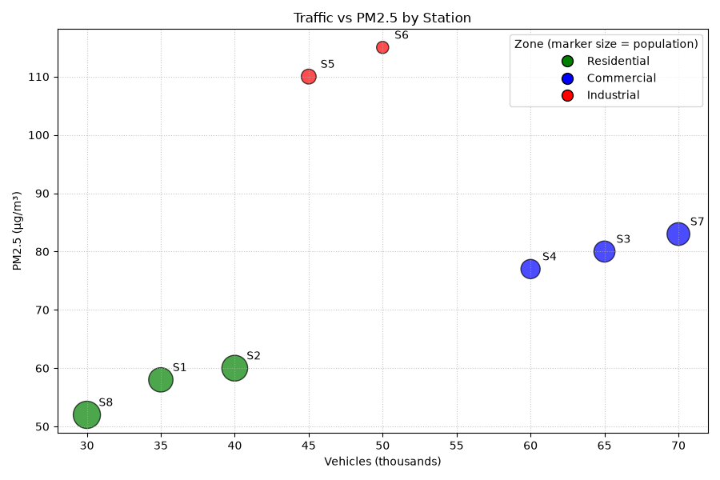

# SYNERGY TASK PHASE

## QUESTION
Q20. Plot vehicles (x-axis) against PM2.5 (y-axis). Use a dictionary and map to color points by zone, scale marker size by population, and add a legend that names the zones. Interpret: which stations break the "more traffic means more pollution" pattern, and what variable explains them?

## PROGRAM
```
import numpy as np
import pandas as pd
import matplotlib.pyplot as plt
from matplotlib.lines import Line2D

stations = pd.DataFrame({
    'station': ['S1', 'S2', 'S3', 'S4', 'S5', 'S6', 'S7', 'S8'],
    'vehicles_k': [35, 40, 65, 60, 45, 50, 70, 30],
    'pm25': [58, 60, 80, 77, 110, 115, 83, 52],
    'zone': ['Residential', 'Residential', 'Commercial', 'Commercial',
             'Industrial', 'Industrial', 'Commercial', 'Residential'],
    'population_k': [40, 45, 30, 25, 15, 10, 35, 50]
})

# Dictionary + map: zone -> color
zone_colors = {'Residential': 'green', 'Commercial': 'blue', 'Industrial': 'red'}
stations['color'] = stations['zone'].map(zone_colors)

# Correlation: all stations vs non-industrial stations
corr_all = stations['vehicles_k'].corr(stations['pm25'])
normal = stations[stations['zone'] != 'Industrial']
corr_normal = normal['vehicles_k'].corr(normal['pm25'])
print("Correlation (all 8 stations)     :", round(corr_all, 3))
print("Correlation (without Industrial) :", round(corr_normal, 3))

# Expected PM2.5 from the non-industrial trend line, and residuals
slope, intercept = np.polyfit(normal['vehicles_k'], normal['pm25'], 1)
stations['expected'] = (intercept + slope * stations['vehicles_k']).round(1)
stations['residual'] = (stations['pm25'] - stations['expected']).round(1)
print("\nTrend line (non-industrial): pm25 = %.2f + %.3f * vehicles_k" % (intercept, slope))
print(stations[['station', 'zone', 'vehicles_k', 'pm25', 'expected', 'residual']])

print("\nMean PM2.5 by zone:\n", stations.groupby('zone')['pm25'].mean().round(1))

# Scatter chart
plt.figure(figsize=(9, 6))
plt.scatter(stations['vehicles_k'], stations['pm25'],
            c=stations['color'], s=stations['population_k'] * 12,
            alpha=0.7, edgecolors='black')
for _, r in stations.iterrows():
    plt.text(r['vehicles_k'] + 0.8, r['pm25'] + 1.5, r['station'])

# Legend that names the zones
handles = [Line2D([0], [0], marker='o', color='w', markerfacecolor=c,
                  markeredgecolor='black', markersize=10, label=z)
           for z, c in zone_colors.items()]
plt.legend(handles=handles, title='Zone (marker size = population)')

plt.title('Traffic vs PM2.5 by Station')
plt.xlabel('Vehicles (thousands)')
plt.ylabel('PM2.5 (µg/m³)')
plt.grid(True, linestyle=':', alpha=0.7)
plt.tight_layout()
plt.show()
```

## OUTPUT
```
C:\Users\anups\SYNERGY>python panda20.py
Correlation (all 8 stations)     : 0.408
Correlation (without Industrial) : 0.998

Trend line (non-industrial): pm25 = 29.71 + 0.772 * vehicles_k
  station         zone  vehicles_k  pm25  expected  residual
0      S1  Residential          35    58      56.7       1.3
1      S2  Residential          40    60      60.6      -0.6
2      S3   Commercial          65    80      79.9       0.1
3      S4   Commercial          60    77      76.1       0.9
4      S5   Industrial          45   110      64.5      45.5
5      S6   Industrial          50   115      68.3      46.7
6      S7   Commercial          70    83      83.8      -0.8
7      S8  Residential          30    52      52.9      -0.9

Mean PM2.5 by zone:
 zone
Commercial      80.0
Industrial     112.5
Residential     56.7
Name: pm25, dtype: float64
```


## Explaination of code
First I created the DataFrame and a dictionary `zone_colors` that links each zone to a color. Then I used `map()` on the zone column to turn every station's zone into its color. For the marker size, I multiplied `population_k` by 12 (a scale factor so the sizes are visible), so more populated stations get bigger circles. Because the markers have different sizes, a default legend would show confusing sizes, so I built the legend by hand with `Line2D` handles, one per zone with equal marker sizes. I computed the correlation for all eight stations and again without the Industrial zone. Then I used `np.polyfit()` on the non-industrial stations to get the trend line "PM2.5 expected from traffic", and subtracted it from the actual PM2.5 to get a residual for every station. Finally, I added the title, axis labels with units, a grid and station labels.

## Interpretation
From the given data , I conclude that S5 and S6, both Industrial stations, break the pattern because they have very high pollution even though their traffic is not very high. The main reason is the industrial zone, where factories and plants may release extra pollution. Residential and Commercial stations follow the traffic pattern more closely. This shows that traffic is not the only reason for air pollution; industrial activity also matters.